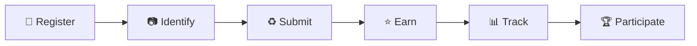

<div align="center">


# 🌍 Earth Reboot

### Scan • Recycle • Earn • Go Green

An open-source smart recycling platform developed by **AXU Studio**.


[Features](#-features) · [How It Works](#-how-it-works) · [Getting Started](#-getting-started) · [Contributing](#-contributing) · [License](#-license)

</div>

---

Earth Reboot is a community-focused recycling platform designed to encourage responsible waste disposal through QR-based bin identification, digital waste submissions, EcoPoints, activity tracking and community leaderboards.

Our goal is to make recycling more engaging, accessible and transparent by connecting people with participating recycling points through technology.

We believe environmental solutions should be accessible to everyone. That's why Earth Reboot is being shared as an open-source project for students, developers, environmentalists and communities to explore, improve and build upon.

## 📸 Screenshots

<div align="center">

| Login | Scan & Submit | Leaderboard |
|:---:|:---:|:---:|
|  |  |  |

</div>

> Add your own screenshots to the `assets/` folder using the file names above.

---

## 🌱 Our Mission

To make recycling participation easier and more engaging through accessible technology, community involvement and transparent activity tracking.

Earth Reboot aims to:

- Encourage responsible recycling habits.
- Make recycling points easier to identify.
- Digitally record recycling participation.
- Promote community involvement through leaderboards.
- Help people understand and participate in sustainable waste management.
- Make the project freely accessible for learning and further development.

## ✨ Features

<table>
<tr>
<td width="50%" valign="top">

### ♻️ Recycling System
- QR-based recycling bin identification
- Waste submission workflow
- Configurable accepted waste categories
- Bin information and availability

</td>
<td width="50%" valign="top">

### 🏆 Engagement System
- EcoPoints and reward tracking
- Activity streaks
- Community leaderboards
- District-level participation rankings

</td>
</tr>
<tr>
<td width="50%" valign="top">

### 👤 User System
- Email and password authentication
- User profiles
- Personal activity tracking
- Points and submission history

</td>
<td width="50%" valign="top">

### 🌐 Accessibility
- Multilingual interface support
- Responsive application interface
- Simple and accessible navigation

</td>
</tr>
<tr>
<td colspan="2" valign="top">

### ⚙️ Administration
- Bin management
- User management
- Submission and points management
- Administrative reporting and PDF export

</td>
</tr>
</table>

> Feature availability may vary between project versions. Check the source code for the current implementation.

---

## 🛠️ Technology Stack

| Technology | Purpose |
|---|---|
| HTML5 | Application structure |
| CSS3 | Styling and responsive layouts |
| JavaScript | Application logic and interactions |
| Firebase Authentication | User authentication |
| Cloud Firestore | NoSQL database |
| Firebase SDK | Frontend integration with Firebase |

## 🏗️ How It Works



1. **Register:** Users create an account and access the application.
2. **Identify:** Users scan the QR code associated with a participating recycling bin.
3. **Submit:** Users record eligible recyclable waste through the application.
4. **Earn:** Accepted submissions can earn EcoPoints.
5. **Track:** Users can view their recorded activity and progress.
6. **Participate:** Leaderboards encourage community-level participation.

## 🗂️ Database Structure

The project uses **Cloud Firestore**, a NoSQL database.

The main collections include:

| Collection | Purpose |
|---|---|
| `users` | User profiles, points and activity information |
| `bins` | Bin IDs, accepted categories and bin information |
| `submissions` | Recorded waste submissions |
| `pointsLedger` | EcoPoints transaction history |

The exact fields and data structure can be explored in the source code.

---

## 🚀 Getting Started

You can explore, modify and run your own instance of Earth Reboot.

### Requirements

- A modern web browser
- A code editor such as Visual Studio Code
- A Firebase account
- Basic knowledge of HTML, CSS and JavaScript

### Installation

**1. Clone the repository**

```bash
git clone YOUR_REPOSITORY_URL
```

**2. Open the project**

Open the cloned project folder in your preferred code editor.

**3. Configure Firebase**

Create your own Firebase project and enable the services required by the application:

- Firebase Authentication
- Cloud Firestore

Then replace every `put your api here` placeholder in the `FIREBASE_CONFIG` block with the values from your own Firebase project settings:

```js
const FIREBASE_CONFIG = {
  apiKey: "put your api here",
  authDomain: "put your api here",
  projectId: "put your api here",
  storageBucket: "put your api here",
  messagingSenderId: "put your api here",
  appId: "put your api here"
};
```

**4. Configure the AI assistant (optional)**

Add your own key to the `AI_CONFIG` block:

```js
const AI_CONFIG = {
  endpoint: "https://openrouter.ai/api/v1/chat/completions",
  apiKey: "put your api here"
  // ...
};
```

> ⚠️ A secret AI key should not be permanently exposed in a production client app. Use a backend proxy for real deployments.

**5. Configure database security**

Set up appropriate Firestore Security Rules before allowing public access.

> ⚠️ Never deploy an application with unrestricted database permissions.

**6. Run the application**

Open the project's entry HTML file using a local development server or your preferred frontend development environment.

---

## 🔐 Security & Privacy

Earth Reboot is shared for community development and learning.

If you deploy your own instance:

- Use your own Firebase project.
- Never commit private credentials or service-account keys.
- Configure secure Firestore Security Rules.
- Restrict administrative operations to authorised users.
- Validate waste submissions and points transactions.
- Review authentication and database permissions before deployment.

Each person deploying the project is responsible for securing their own installation.

## 🧪 Project Development

Earth Reboot has evolved through multiple development stages, including interface redesigns, Firebase integration, multilingual experiments, recycling workflows, administrative features and performance improvements.

The project is continuously open to improvements, experimentation and community contributions.

## 🔮 Future Scope

- [ ] Physical smart-bin integration
- [ ] Sensor-based bin monitoring
- [ ] Automated waste-category identification
- [ ] Improved recycling-point networks
- [ ] Better environmental impact reporting
- [ ] Community and institutional partnerships
- [ ] Additional language support
- [ ] Backend and architecture improvements

_These are potential development directions, not claims that the hardware or integrations are already implemented._

## 🤝 Contributing

Earth Reboot is open to contributions from everyone.

You can contribute by:

- Improving the existing application
- Fixing bugs
- Improving the interface and accessibility
- Adding language translations
- Improving documentation
- Suggesting new recycling features
- Improving database structure and security
- Exploring hardware integration

### Contribution Guidelines

1. Fork this repository.
2. Create a new branch for your changes.
3. Make and test your improvements.
4. Submit a Pull Request explaining your contribution.

Please keep contributions relevant to the project's environmental mission.

## 📜 License

Earth Reboot is released under the **MIT License**.

You are free to use, copy, modify, distribute and build upon this software, including for commercial purposes, subject to the conditions of the MIT License.

See the [LICENSE](LICENSE) file for the complete terms.

## 🏢 Project Credits

| | |
|---|---|
| **Project** | Earth Reboot |
| **Studio** | AXU Studio |
| **Developer** | Earth Reboot Team |
| **Year** | 2026 |

---

## 💚 A Message to the Community

Recycling is not the responsibility of one person, one organisation or one application. It is a collective effort.

Earth Reboot is our contribution to that effort.

We are making the project open source so that anyone can learn from it, improve it, adapt it and help take the idea further.

You don't need to be part of AXU Studio to contribute to a greener future.

<div align="center">

### Build. Improve. Share. Reboot Earth. 🌍

<sub>Earth Reboot — An open-source initiative by AXU Studio. Built for learning, collaboration and a greener tomorrow.</sub>

</div>
